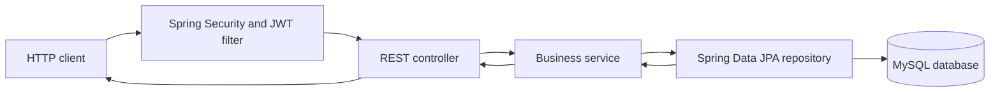
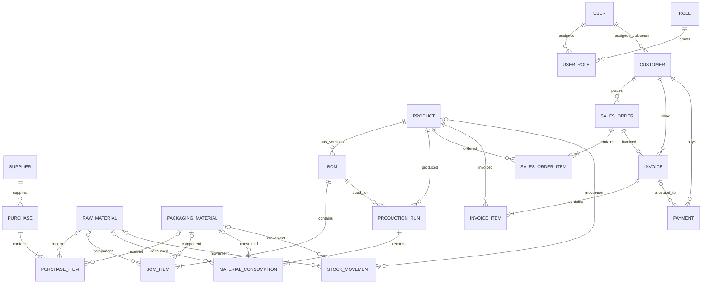

# Order-to-Audit Management System — Design

This document describes the backend implementation in `ordertoaudit/src/main/java/com/nittrichy/ordertoaudit`. It reflects the current entities, services, repositories, controllers, and configuration; it does not describe planned behavior.

## 1. System architecture

The request path follows the standard layered structure below. Controllers map HTTP requests to service calls, services apply business rules and transaction boundaries, repositories load and persist JPA entities, and the datasource connects to MySQL in the normal application configuration. Tests use H2.



Services return DTOs or entities to controllers; controllers expose JSON responses or generated invoice/report files. `GlobalExceptionHandler` maps application exceptions to API error responses.

## 2. Package structure

Root Java package: `com.nittrichy.ordertoaudit`.

| Package | Implemented responsibility |
| --- | --- |
| `config` | Spring Security configuration and role/bootstrap initialization |
| `controller` | REST controllers for auth, master data, BOMs, purchases, production, inventory, orders, dispatch, invoices, payments, reports, and benchmark |
| `dto` | Request and response objects used at the HTTP boundary |
| `entity` | JPA entities mapped to database tables |
| `enums` | Role, order, invoice, purchase, production, payment, movement, and item classifications |
| `exception` | Business, stock, and not-found exceptions and global API error handling |
| `repository` | Spring Data JPA repositories and selected locking queries |
| `security` | JWT token creation/validation, request filter, principal, and user lookup |
| `service` | Business workflows and transaction management |
| `util` | PDF invoice and Excel/CSV report generation |

`OrdertoauditApplication` is the Spring Boot entry point. Main configuration is in `src/main/resources/application.properties`; test configuration and H2 settings are in `src/test/resources/application-test.properties`.

## 3. Entities and database relationships

Entities inherit `createdAt` and `updatedAt` timestamps from `BaseEntity`, except `AuditLog`, which defines its own timestamp. Identifiers are generated by JPA. Enum values are stored as strings. Monetary and stock values use `BigDecimal` columns with declared precision and scale.



The diagram uses optional links (`o|`) where the entity field is nullable. In particular, a `PurchaseItem`, `BOMItem`, `MaterialConsumption`, or `StockMovement` points to the material/product type indicated by its enum and may leave the other item references null. The schema does not declare a database-level check constraint enforcing that exactly one such reference is set; services select the reference based on the item type.

Key table groups:

- **Master data:** `customers`, `suppliers`, `products`, `raw_materials`, and `packaging_materials`.
- **Purchasing and production:** `purchases`, `purchase_items`, `boms`, `bom_items`, `production_runs`, and `material_consumptions`.
- **Sales and accounting:** `sales_orders`, `sales_order_items`, `invoices`, `invoice_items`, and `payments`.
- **Inventory and security:** `stock_movements`, `users`, `roles`, and the JPA join table `user_roles`.
- **Audit log model:** `audit_logs` stores entity name/id, action, username text, timestamp, IP address, and details. An `AuditLog` entity and repository exist, but no service currently writes operational actions to this table.

`Invoice` has a unique one-to-one relationship to `SalesOrder`. Invoice and purchase documents own their item rows with cascade and orphan removal. `User` and `Role` have a many-to-many relationship through `user_roles`. Stock movements use nullable foreign keys for product/raw/packaging targets and capture a `ReferenceType`, optional reference id, and reference number.

## 4. Main business workflows

### Purchase

`PurchaseService.recordPurchase` creates a purchase with status `RECEIVED`, supplier, date, items, and total. Each item is classified as raw material or packaging material. Raw-material receipts update the weighted average cost using the existing stock/cost and incoming quantity/price. Packaging receipts update the packaging unit cost. Both create positive stock movements through `InventoryService` in the same transaction.

### BOM

`BomService` creates and updates a BOM for a product, with batch size, version, active flag, and BOM items. BOM items reference raw or packaging materials according to `ItemType`. The service validates a positive batch size and item quantities, supported types, and component references. When a new BOM is activated for a product, the service deactivates its currently active BOMs while holding a product row lock.

### Production

`ProductionService.recordProductionRun` loads the selected BOM or the single active BOM for the product and verifies that the BOM belongs to the selected product. Expected output is BOM batch size multiplied by batch multiplier. For each BOM component, planned quantity is scaled by the multiplier; request values can provide actual and damaged quantities. The service issues actual plus damaged input quantities from inventory, records consumption and variance, and receives actual good output as finished-goods stock. It stores yield variance and calculates production cost from raw-material cost, packaging cost, labour, and overhead.

### Inventory

Inventory is maintained per product, raw material, and packaging material using each entity's `currentStock` field. `InventoryService` reloads the stock row using a pessimistic write lock, computes `closingStock = openingStock + signedQuantity`, rejects a negative result, updates the balance, and saves a corresponding `StockMovement` in the same transaction. Positive quantities are receipts; negative quantities are issues, dispatches, or damages. New master data can supply an opening quantity; that quantity is recorded as an opening-balance movement rather than retained as an unledgered balance.

The movement row stores signed quantity, opening and closing balances, unit price, movement type, reference fields, remarks, and creator. The ledger view reads movement rows; the service does not reconstruct `currentStock` by summing the ledger on each request.

### Sales

`SalesOrderService` creates a `PENDING_APPROVAL` order with line quantities, unit prices, taxable amounts, product GST rate snapshots, and totals. Missing order numbers are generated. Approval records approver and timestamp and sets the order to `APPROVED` or `REJECTED`. Approval performs a stock check that logs a warning when stock is short; it does not itself deduct stock or block approval. Dispatch performs the hard availability check.

### GST invoicing

Dispatch automatically asks `InvoiceService` to create an invoice if the order has no invoice. The invoice captures the order, customer, place of supply, invoice/due dates, line amounts, tax components, payment totals, and status. The due date is 15 days after invoice date. The company home state and state code come from `app.company.state` and `app.company.state-code`.

For each line, taxable amount is quantity multiplied by the order's unit-price snapshot, rounded to two decimal places. The GST rate comes from the order-line snapshot, falling back to the product GST rate if that snapshot is absent. If the customer's state code differs from the configured company state code, the full rate is applied as IGST. Otherwise, half the rate is applied separately as CGST and SGST. Amounts use `BigDecimal` and `HALF_UP` rounding. Totals are accumulated per invoice; header rates are effective aggregate rates when lines may have different rates. The generated invoice increases the customer's outstanding balance by the invoice total.

### Dispatch

`DispatchService` locks the sales-order row, requires status `APPROVED`, and prevents a second dispatch. It checks every line against current product stock, records negative finished-goods movements, marks the order `DISPATCHED`, adds dispatch metadata, and generates the invoice. These operations are in one transaction; an insufficient-stock exception rolls back the transaction.

### Payments

`PaymentService.recordPayment` locks the customer row and rejects non-positive amounts, duplicate payment numbers, amounts greater than the customer's outstanding balance, and invoice overpayments. When an invoice id is provided, it locks that invoice, verifies that it belongs to the customer and is payable, then updates invoice paid/outstanding amounts and status. Without an invoice id, it allocates FIFO over the customer's unpaid invoices by invoice date. Advance payments are not supported; an amount exceeding allocatable invoice balances is rejected. It then reduces customer outstanding balance by the same amount and records the payment. The updates are transactional.

## 5. JWT authentication and role security

`SecurityConfig` configures stateless Spring Security, BCrypt password encoding, and the JWT request filter. CSRF is disabled for this stateless API. The filter reads a `Bearer` token, validates its signature and expiry through `JwtTokenProvider`, reloads the user and current roles, and places the authentication in the security context. Normal API requests require authentication; `/api/auth/**`, API documentation routes, and `/error` are permitted at the HTTP security layer.

Method security further restricts write operations. Implemented role groups include:

- Product create/update: `ADMIN`, `OWNER`.
- Customer create: `ADMIN`, `SALESMAN`, `OWNER`; update: `ADMIN`, `OWNER`.
- Supplier and raw/packaging material create: `ADMIN`, `OWNER`, `PRODUCTION`.
- BOM create/update: `ADMIN`, `OWNER`, `PRODUCTION`.
- Purchase and production writes: `ADMIN`, `OWNER`, `PRODUCTION`.
- Sales-order creation: `SALESMAN`, `ADMIN`, `OWNER`; approval: `ADMIN`, `OWNER`.
- Dispatch and benchmark routes: `ADMIN`, `OWNER`.
- Payment writes: `ADMIN`, `ACCOUNTANT`, `OWNER`.

Public registration assigns the `SALESMAN` role. The JWT secret is supplied using `JWT_SECRET`; passwords are stored through the BCrypt encoder.

## 6. Stock ledger and calculation

`StockMovement.quantity` is signed: positive for stock additions and negative for stock issues. A movement snapshots `openingStock` and `closingStock`; the service calculation is:

```text
closingStock = openingStock + quantity
```

The service checks `closingStock >= 0` before saving. For each movement, it updates the stock item's `currentStock` and saves the movement row under the same transaction and write lock. Purchase receipts, production inputs/output, dispatches, and opening stock route through this service. Raw-material weighted-average cost is updated during purchase receipt; packaging unit cost is set from the receipt price. Finished-goods valuation is not represented as a separate cost ledger field in the product entity.

## 7. GST calculation

The sale line snapshots the product's configured GST rate in `SalesOrderItem`. Invoice generation uses that snapshot, so a later product rate change does not alter the rate recorded on an already-created order. State-code comparison determines whether the invoice is inter-state. For intra-state invoices, CGST and SGST each use half the configured rate; for inter-state invoices, IGST uses the full rate. Taxable line values, tax amounts, and totals are `BigDecimal` calculations rounded to two decimal places with `RoundingMode.HALF_UP`.

## 8. Payment and outstanding balance

On invoice creation:

```text
invoice.outstandingAmount = invoice.grandTotal
customer.outstandingBalance += invoice.grandTotal
```

For a payment:

```text
invoice.paidAmount += allocatedAmount
invoice.outstandingAmount -= allocatedAmount
customer.outstandingBalance -= payment.amount
```

An invoice becomes `PARTIALLY_PAID` while it has a positive remaining balance and `PAID` when settled. Customer balances are not clamped to zero; payments that exceed the customer balance or invoice/FIFO allocation are rejected. There is no advance-payment workflow.

## 9. Transactions and concurrency

Service methods that perform business writes use Spring `@Transactional`; read methods are marked read-only where implemented. This groups document creation, stock updates, movements, invoice totals, and customer/payment balance changes so a failure rolls the workflow back.

Repositories provide `PESSIMISTIC_WRITE` queries for stock entities, customers, invoices, and sales orders. Inventory movement methods re-read the stock entity under a write lock before calculating its closing balance. Purchase receipt locks material rows before updating costs and stock. BOM activation locks the product row before switching active BOMs. Payment and invoice workflows lock the customer; invoice payment also locks the invoice. Dispatch locks its sales order to prevent two concurrent dispatches of the same order. The entities do not use JPA `@Version` optimistic locking; the current concurrency approach is pessimistic row locking.

## 10. Benchmark isolation and safety

`BenchmarkService.runBenchmark` is transactional and checks all of the following before creating scenario records:

1. `app.benchmark.enabled` is true (`BENCHMARK_ENABLED=true` in the environment).
2. The active Spring profile is `demo` or `test`.
3. The configured JDBC URL starts with `jdbc:h2:`.
4. The business tables checked by the service are empty.

The benchmark does not delete existing business data and does not run automatically during startup. It creates a supplier, materials, product, BOM, purchase, production run, customer orders, invoice/payment, and then checks a dispatch shortage. The controller additionally requires `ADMIN` or `OWNER`. H2 is configured for the test scope and the benchmark is enabled in `application-test.properties` for the isolated benchmark integration test.

`GET /api/benchmark/status` currently returns 501 because results are not persisted; it does not execute the scenario. The separate `AuditLog` table is not written by the benchmark or the operational services in the current source.
